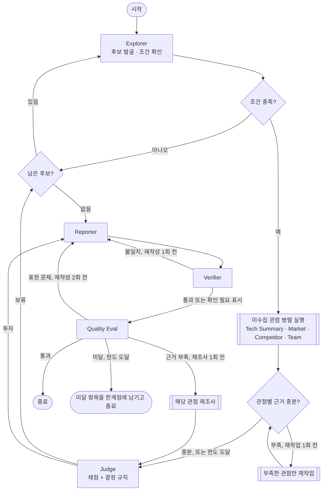

# AI Semiconductor Startup Investment Evaluation Agent
본 프로젝트는 국내 AI 반도체 스타트업을 발굴하고, 기술 성숙도·시장성·이해관계자·도메인 적용 관점에서 평가해 투자 보고서를 작성하는 시스템을 **Supervisor 패턴** 기반으로 설계/개발하는 프로젝트임.

## Overview
- Objective : 웹 기사와 공공 연구기관 보고서를 근거로 스타트업을 6개 항목 기준표로 채점해 투자/보류를 결정하고, 출처가 붙은 평가 보고서를 작성
- **Pattern** : Supervisor — 무엇을 몇 번 조사할지 미리 정할 수 없는 과제라서 선택
  - 평가할 후보 수는 앞 후보의 결과(조건 미충족·보류)에 따라, 다시 조사할 관점은 수집 결과에 따라 정해진다
  - 근거가 충분한지 판단한 뒤에 보고서를 써야 하고, 근거가 부족한 관점만 골라 재작업시켜야 한다
  - Orchestrator-Workers는 처음에 계획을 세워 나누는 방식이라, 결과를 보고 다음 일을 정하는 이 흐름에 맞지 않았다
- **동적 처리** : 순서를 코드에 고정하지 않고, Supervisor가 매 단계 State(수집된 관점, 근거 충분도, 판단 결과, 검증·품질 평가 결과)를 보고 다음 노드를 정한다
  - 아직 없는 관점만 병렬 실행하고, 근거가 부족한 관점만 사유·보완 대상과 함께 재작업시킨다
  - 조건 미충족·보류면 다음 후보로 넘어가고, 투자 결정이 나오면 보고서를 쓴다
  - 사실 검증 불일치면 재작성, 품질 평가가 근거 부족을 짚으면 해당 관점 재조사 후 재판단, 표현 문제면 재작성

## Selected Technologies
- 평가 대상 : **국내 AI 반도체 설계 스타트업 — 비상장·Seed~Series C·Exit 전으로, 투자 검토가 가능한 단계의 기업**
- 세부 분야 : **데이터센터·엣지·차량용·인프라·기타 — 시장 규모·성장률과 경쟁사를 같은 분야 기준으로 비교하기 위해 구분**
- 최종 선정 : **엑시나 (인프라·CXL 메모리, 시리즈 B) — 후보 5곳 중 환산 점수 74.0점으로 투자 기준(70점) 충족**

## Features
- PDF 자료 기반 정보 추출 : 공공 연구기관 보고서 10편(182쪽)을 기술·시장 문서로 나눠 RAG로 검색 (KDB 보고서 글꼴 손상 쪽은 OCR로 보정)
- 실시간 웹 검색 : Tavily로 후보 발굴과 기업 사실 수집, 근거마다 게시일 표시. 블로그·SNS·포털 재전송 같은 2차 출처는 원본을 확인한 뒤에만 사용
- 기준표 채점과 규칙 기반 결정 : LLM은 추출·채점만 하고, 정보 부족 상한(최대 2점)·기준표 상한·환산 점수·투자/보류(70점 이상)는 코드로 결정
- 사실 검증 : 수치·점수 대조 → RAG 원문 대조(Self-RAG) → LLM 검수. 불일치면 재작성, 끝내 남으면 "(확인 필요)" 표시
- 확증 편향 방지 전략 : 관점마다 근거 발행처 2곳 이상, 웹 근거가 모두 같은 날 보도면 재작업. 경쟁사 비교는 원문으로 확인된 주장만 쓰고 회사 발표·의견은 구분. 보고서는 인용 발행처 3곳 이상, 출처 하나가 인용의 40% 이하
- 보고서 품질 평가 : Groundedness·중립성·편향 통제를 코드 검사 + LLM Judge(Hybrid)로 판정. 미달이면 재작성(최대 2회)하거나 근거가 부족한 관점을 재조사하고, 한도에 도달하면 미달 항목을 보고서 한계점에 남긴다

## Tech Stack
- Framework : LangGraph
- LLM/Generator : gpt-4.1-mini (temperature 0, seed 42)
- LLM/Judge : gpt-4.1
- Retrieval : Chroma - Hit Rate@3 0.96, Hit Rate@5 0.98, MRR@5 0.837
- Embedding : nlpai-lab/KURE-v1 (후보 3종을 우리 문서로 비교해 선정)
- Web Search / Tracing : Tavily / LangSmith

## Agents
- Supervisor : State를 보고 다음 노드 결정. 관점별 근거 충분성 판정, 재작업 요청, 반복 상한·종료 관리, 결정 로그 기록
- Explorer : 후보 최대 5곳 발굴, 후보마다 상장 여부·투자 단계·Exit 조건 확인과 세부 분야 분류
- Tech Summary : 칩·공정·개발 단계·성능·실적 수집(웹)과 업계 기준 해석(RAG), 근거 일치 검사
- Market : 세부 분야 시장 규모·성장률·수요 요인 추출(RAG). 수치가 부족하면 기술 문서까지 재검색
- Competitor : 같은 분야 경쟁사·비교 주장·차별점 정리. 원문으로 확인된 주장만 사용, 선도(대기업·상장사)/동급(비상장) 구분
- Team : 창업자·핵심 인력 경력 정리
- Judge : 6개 항목 1~5점 채점, 코드 규칙으로 상한·환산 점수·투자/보류 결정. 같은 기업 과거 평가와 크게 다르면 재채점
- Reporter : 보고서(마크다운·PDF) 작성. 점수표·채점 근거·경쟁 구도 표와 REFERENCE는 코드가 생성
- Verifier : 보고서 사실 검증 (수치·점수 대조, 원문 대조, LLM 검수)
- Quality Eval : 보고서 품질 평가 (Groundedness·중립성·편향 통제)

## State Schema
- **제어 vs 페이로드 분리** : 작업 결과(후보, 기업 정보, 관점별 분석 4개, 점수, 보고서, 검증·평가 결과)는 하위 노드가 쓰고, 제어 메타(실행 횟수, 후보 순번, 다음 노드, 근거 충분도, 재작업 횟수·요청, 보고서 버전, 재작성·재조사 횟수, 마지막 결정)는 Supervisor만 쓴다. 하위 노드가 제어 키를 쓰지 않는지 테스트로 확인한다
- **관측성 위치** : 결정과 사유 전체는 State 밖 `outputs/decisions/{trace_id}.jsonl`에 남기고, State에는 마지막 결정 한 줄(`last_decision`)만 둔다
- **지속성 비용** : 로그 본문은 State 밖에 두고, 다음 후보로 넘어갈 때 이전 기업의 분석·보고서·출처를 비워 체크포인트마다 저장되는 State가 쌓이지 않게 했다
- **상관** : 실행마다 만든 `trace_id` 하나를 State, LangSmith run metadata, 결정 로그 파일, 체크포인터 `thread_id`에 같이 넣는다
- **재개/복구** : 단계마다 State를 SQLite 체크포인트에 저장해 `--resume <trace_id>`로 이어서 실행한다. 하위 노드 오류는 대체 결과로 바꿔 Supervisor가 재시도·다음 후보·보류를 정한다
- **동시 처리** : 병렬로 도는 분석 노드는 각자 다른 키에만 쓰고, 함께 쓰는 출처·보류 기록·오류 목록은 reducer(중복 제거 병합, 누적)로 합친다
- **종료 보장** : Supervisor 실행 40회, 관점당 재작업 1회, 재조사 1회, 사실 검증 재작성 1회, 품질 재작성 2회, 후보 최대 5곳 상한. 마지막 안전장치로 LangGraph `recursion_limit` 90

## Architecture
모든 하위 노드는 실행 후 Supervisor로만 돌아가고(Star 구조), 분기는 `add_conditional_edges` 하나로 한다. 아래는 Supervisor의 라우팅 규칙이다.



**LangSmith 실행 trace** (`invest-supervisor-8923c8ed`, Supervisor 22회)

| 캡처 | 장면 |
|---|---|
| [tracing-1](docs/tracing-1.png) ~ [tracing-4](docs/tracing-4.png) | 전체 실행 트리. 후보 iHW 병렬 수집 → 근거 부족 재작업 → 보류 후 다음 후보 → 엑시나 수집·재작업 → 투자 → 사실 검증 재작성 → 품질 평가 근거 부족 재조사·재판단 → 재작성 → 한도 도달 종료 |
| [tracing-5](docs/tracing-5.png) | Supervisor 결정: 팀 근거 부족(공개 정보 부족, 같은 날 보도) → team 재작업 |
| [tracing-6](docs/tracing-6.png) | Supervisor 결정: iHW 보류(68.0점) → 다음 후보 엑시나 |
| [tracing-7](docs/tracing-7.png) | Supervisor 결정: 품질 평가 근거 부족 → 기술·팀·시장 관점 재조사 |

트리에서는 노드가 위아래로 나열되지만, Supervisor 바로 다음에 이어진 분석 노드들은 같은 단계에서 병렬로 실행된 것이다. 실시간 웹 검색을 쓰므로 다시 실행하면 후보와 결과가 달라질 수 있다.

## Directory Structure
```
├── agents/           # 에이전트 모듈 (supervisor, explorer, tech_summary, market, competitor, team,
│                     #   judge, reporter, verifier, quality, web 검색 공통). 프롬프트는 각 파일 안에 있다
├── rag/              # 문서 적재, 임베딩, 검색기, OCR 보정
├── data/             # 문서 풀 (tech/, market/), OCR 텍스트
├── eval/             # 임베딩 선정 실험, 시장성 평가 정답지
├── tests/            # 단위 테스트 (API 키 없이 실행)
├── docs/             # 역할 분담, LangSmith 캡처
├── outputs/          # 실행 결과 (보고서 md·PDF, 결정 로그, 체크포인트)
├── state.py          # State 정의
├── graph.py          # LangGraph 그래프
├── obs.py            # 결정 로그 (관측성)
├── config.py         # 모델·가중치·임계값·반복 상한
├── app.py            # 실행 스크립트
└── README.md
```

## Usage
```bash
uv sync                                   # 의존성 설치 (또는 pip install -r requirements.txt)
uv run python -m rag.ingest               # 최초 1회: 문서 임베딩
uv run python app.py                      # 실행 → outputs/ 에 보고서(md·PDF)와 결정 로그
uv run python app.py --resume <trace_id>  # 멈춘 실행 이어서
```
`.env`에 `OPENAI_API_KEY`, `TAVILY_API_KEY`, `LANGSMITH_API_KEY`가 필요하다.

## Contributors
- 강지수 : 시장성 평가 에이전트, README
- 김다은 : 보고서 품질 평가 노드, 투자 판단 에이전트
- 이진우 : 보고서 생성·사실 검증 에이전트, PDF
- 이채목 : State·Supervisor·Graph 설계, 탐색·팀 분석·경쟁사 비교 에이전트
- 장정훈 : 기술 요약 에이전트
