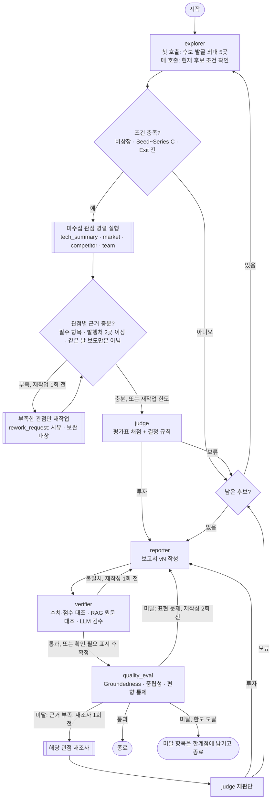

# AI Semiconductor Startup Investment Evaluation Agent

## 목차

1. [Overview](#overview)
2. [시각화](#시각화)
3. [Selected Technologies](#selected-technologies)
4. [Features](#features)
5. [Tech Stack](#tech-stack)
6. [Agents](#agents)
7. [State Schema](#state-schema)
8. [Architecture](#architecture)
9. [보고서 품질 평가](#보고서-품질-평가)
10. [투자 판단 기준](#투자-판단-기준)
11. [LangSmith Tracing](#langsmith-tracing)
12. [Evaluation & Validation](#evaluation--validation)
13. [실행 결과와 재현성](#실행-결과와-재현성)
14. [투자 보고서 핵심 포인트](#투자-보고서-핵심-포인트)
15. [Directory Structure](#directory-structure)
16. [Usage](#usage)
17. [Lessons Learned](#lessons-learned)
18. [Contributors](#contributors)

본 프로젝트는 국내 AI 반도체 스타트업을 발굴하고, 기술 성숙도·시장성·이해관계자·도메인 적용 관점에서 근거를 모아 투자 적합성을 평가하는 **Supervisor 패턴** 기반 Multi-Agent 시스템이다. 근거가 충분한지 Supervisor가 판단한 뒤에만 보고서를 쓰고, 보고서는 사실 검증과 품질 평가를 통과할 때까지 다시 쓴다.

## Overview
- **Objective** : AI 반도체 스타트업의 기술·제품 성숙도, 시장성, 창업자·팀, 실적, 경쟁 우위, 투자조건을 기준표로 채점해 투자/보류를 결정하고 출처가 붙은 보고서를 만든다
- **Pattern** : Supervisor — 무엇을 몇 번 조사해야 하는지 미리 정할 수 없는 과제라서 골랐다.
  - 후보가 몇 곳까지 평가될지는 앞 후보의 결과(조건 미충족·보류)에 따라 달라진다
  - 근거가 부족한 관점만 다시 조사해야 하고, 어느 관점이 부족할지는 수집 결과를 봐야 안다
  - 보고서는 근거 충분성 판단 뒤에 써야 하고, 사실 검증·품질 평가 결과에 따라 재작성·재조사로 되돌아가야 한다
  - Orchestrator-Workers는 처음에 계획을 세워 나누는 방식이라, 결과를 보고 다음 일을 정하는 이 흐름에는 맞지 않았다
- **동적 처리** : 순서를 코드에 박아 두지 않고, Supervisor가 매번 State(수집된 관점, 근거 충분도, 판단 결과, 검증 결과)를 보고 다음 노드를 정한다
  - 아직 없는 관점만 병렬 실행하고, 근거가 부족한 관점만 사유·보완 대상과 함께 재작업시킨다
  - 조건 미충족·보류면 다음 후보로 넘어가고, 투자 결정이 나오면 보고서를 쓴다
  - 사실 검증 불일치면 재작성, 품질 평가가 근거 부족을 짚으면 해당 관점 재조사 → 재판단, 표현 문제면 재작성
  - 모든 반복에는 상한이 있다 (관점당 재작업 1회, 재조사 1회, 사실 검증 재작성 1회, 품질 재작성 2회, Supervisor 40회)

## 시각화
해당 프로젝트가 실행되는 전 과정은 아래 Repo를 통해 시각화 하였다.

> 📌 https://github.com/97-99-02/web.git


## Selected Technologies
- **평가 대상** : 국내 AI 반도체 설계 스타트업 — 비상장, 투자 단계 Seed ~ Series C, Exit 전 (상장 추진·프리IPO·시리즈 D 이상은 제외)
- **세부 분야** : 데이터센터 · 엣지 · 차량용 · 인프라(메모리·인터커넥트) · 기타. 시장성 수치와 경쟁사는 같은 세부 분야 기준으로 본다
- **선정 방식** : 고정 검색어(세부 분야별 1개 이상)로 후보를 최대 5곳 발굴하고, 순서대로 평가하다 처음 투자 결정이 나오면 멈춘다. 모두 보류면 '추천 기업 없음' 보고서를 쓴다

## Features
- **LLM은 추출·채점, 계산과 결정은 코드** : 조건 충족, 수치 원문 대조, 세부 분야 판정, 정보 부족 상한, 기준표 상한, 환산 점수, 투자/보류 결정은 코드 규칙이다
- **기관 보고서 기반 RAG** : 공공 연구기관 보고서 10편(182쪽)을 기술·시장 문서로 나눠 적재 (KDB 보고서 글꼴 손상 20쪽은 OCR로 보정). 시장성은 시장 문서에 세부 분야 수치가 없으면 기술 문서까지 다시 찾는다 (Corrective RAG)
- **실시간 웹 검색과 2차 출처 확인** : 기업 사실은 Tavily로 그날 검색한다. 블로그·뉴스레터·위키·SNS·포털 재전송 같은 2차 출처는 원문 링크(또는 제목 검색)로 원본을 찾아 내용이 맞으면 원본으로 바꾸고, 확인하지 못한 블로그류는 근거에서 뺀다
- **근거에 날짜를 붙인다** : 웹 근거마다 게시일(Tavily → URL → 기사 페이지)을 달아 넘기고, '올해·내년'은 기사 게시일 기준 연도로, 과거 계획 인용은 현재 계획으로 쓰지 않는다
- **확증 편향 방지 전략** : 관점마다 근거 발행처 2곳 이상, 웹 근거가 모두 같은 날 보도(보도자료 재전송)면 근거 부족으로 재작업. 경쟁사 비교는 원문으로 확인된 주장만 쓰고 회사 발표·의견은 구분해 표시한다. 보고서는 인용 발행처 3곳 이상, 출처 하나가 인용의 40% 이하, 기관 보고서와 웹 출처를 모두 인용해야 한다
- **사실 검증 3단계** : ① State 대조(값+단위, 항목 점수 표기, 인용 번호) → ② RAG 원문 대조(Self-RAG) → ③ LLM 검수. 불일치면 1회 재작성, 남으면 "(확인 필요)" 표시
- **보고서 품질 평가** : Groundedness · 중립성 · 편향 통제를 코드 검사 + LLM Judge(Hybrid)로 판정하고 미달이면 Loop (→ [보고서 품질 평가](#보고서-품질-평가))
- **재개/복구** : 단계마다 State를 SQLite 체크포인트에 저장하고, 멈추면 `--resume <trace_id>`로 이어서 실행한다. 웹 검색 한도(429)는 기다렸다 다시 검색한다

## Tech Stack
- Framework : LangGraph (StateGraph, `add_conditional_edges`, SqliteSaver)
- LLM/Generator : gpt-4.1-mini (temperature 0, seed 42) — 탐색·기술 요약·시장성·경쟁사·팀·보고서·사실 검증
- LLM/Judge : gpt-4.1 (생성 모델과 다른 모델) — 투자 판단, 보고서 품질 평가
- Retrieval : Chroma — Hit Rate@3 0.96, Hit Rate@5 0.98, MRR@5 0.837 (임베딩 선정 실험)
- Embedding : nlpai-lab/KURE-v1 (오픈소스, 후보 3종 비교로 선정)
- Web Search : Tavily
- Tracing : LangSmith (run_name `invest-supervisor-{trace_id 앞 8자리}`, metadata `trace_id`)

## Agents

| 노드 | 하는 일 | 도구 | 코드가 확정하는 것 |
|---|---|---|---|
| **supervisor** | State를 보고 다음 노드 결정 (라우팅·재작업·종료) | - | 관점별 근거 충분성, 재작업 요청(사유·보완 대상), 반복 상한, 결정 로그 |
| explorer | 후보 발굴, 후보별 조건 확인 | 웹 | 상장 여부·투자 단계·Exit 조건 판정, 세부 분야 분류 |
| tech_summary | 칩·공정·개발 단계·성능·실적 수집, 업계 기준으로 해석 | 웹 + RAG(tech) | Self-RAG 관련성·근거 일치 검사, 빈 항목만 다른 검색어로 재검색 |
| market | 시장 규모·성장률·수요 요인·리스크 | RAG(market → tech) | 수치 원문 대조, 단위·연도·전망 판정, 세부 분야 수치 판정 |
| competitor | 경쟁사·비교 주장·차별점·경쟁 리스크 | 웹 | 주장 숫자·연도 원문 확인, 의견·투자 정보 제외, 선도(대기업·상장사)/동급(비상장) 구분 |
| team | 창업자·핵심 인력 경력 | 웹 | - |
| judge | 항목별 1~5점·근거·법률 리스크 | - | 정보 부족 최대 2점, 기준표 상한(시장성·경쟁 우위·투자조건), 환산 점수, 투자/보류, 일관성 재채점 |
| reporter | 보고서 문장 작성 | - | 점수표·채점 근거·경쟁 구도·개발 단계 표, REFERENCE, 형식·점수 표기 점검, PDF |
| verifier | 원문 모순 검수 | RAG | 수치·단위·점수 대조, 인용 번호, 원문 대조, "(확인 필요)" 표시 |
| quality_eval | 내용 판정 (LLM Judge) | - | 3개 항목 코드 검사, 미달 사유를 재작성 지시 / 재조사 대상으로 변환 |

하위 노드끼리는 직접 연결되지 않는다. 모든 노드는 실행 후 supervisor로만 돌아가고, 서로의 결과는 State로만 주고받는다.

## State Schema
`state.py`의 `GraphState`. 설계 원칙: State에는 제어 흐름과 재개에 필요한 것만 두고, 로그 본문은 밖으로 뺀다.

- **제어 vs 페이로드 분리** : 페이로드(`candidates`, `company`, 관점별 분석 4개, `scores`, `report`, `verify_result`, `eval_result`)는 하위 노드가 쓰고, 제어 메타(`step_count`, `current_index`, `next_nodes`, `evidence_status`, `rework_count`, `rework_request`, `report_version`, `retry_count`, `quality_loops`, `research_loops`, `reopen_stage`, `last_decision`, `last_error`)는 supervisor만 쓴다. 하위 노드 반환값에 제어 키(`CONTROL_KEYS`)가 없는지 테스트로 확인한다
- **관측성 위치** : 결정과 사유 전체는 State 밖 `outputs/decisions/{trace_id}.jsonl`에 쌓고(`obs.log_decision`), State에는 마지막 결정 한 줄(`last_decision`)만 둔다. 에이전트 진단(검색어, 버린 주장)도 결정 로그로 보낸다
- **지속성 비용** : 체크포인트마다 저장되는 State가 커지지 않게 했다. 로그 본문은 State 밖에 두고, 다음 후보로 넘어갈 때 이전 기업의 분석·보고서(`RESET_ON_NEXT`)와 출처(`SOURCES_RESET` 표시를 reducer가 처리)를 비운다. 보고서는 버전마다 덮어쓴다(`report_version`만 증가)
- **상관** : 실행마다 만든 `trace_id` 하나를 State, LangSmith run metadata·run_name, 결정 로그 파일 이름, 체크포인터 `thread_id`에 같이 넣는다
- **재개/복구** : `SqliteSaver`가 단계마다 State를 `outputs/checkpoints.sqlite`에 저장한다. 실행 중 예외면 같은 실행 안에서 마지막 체크포인트부터 1회 이어가고, 프로그램이 꺼지면 `--resume <trace_id>`로 이어간다. 하위 노드 예외는 노드별 대체 결과와 `agent_errors`로 바꿔 supervisor가 재시도·진행을 정한다(분석 실패 → 재작업, 탐색 오류 → 다음 후보, 판단 오류 → 보류)
- **동시 처리** : 분석 노드 4개가 같은 단계에 병렬로 돈다. 결과는 각자 다른 키에만 쓰고, 여러 노드가 함께 쓰는 `sources`(중복 제거 reducer `merge_sources`), `rejected`·`agent_errors`(`operator.add`)는 reducer로 병합한다
- **종료 보장** : supervisor 실행 40회(`MAX_STEPS`) 초과 시 보고서가 없으면 지금까지 결과로 작성 후 종료, 관점당 재작업 1회, 재조사 1회, 사실 검증 재작성 1회, 품질 재작성 2회, 후보 최대 5곳. 마지막 안전장치로 LangGraph `recursion_limit` 90

## Architecture

**Supervisor 라우팅** (`agents/supervisor.py`의 라우팅 규칙. 모든 화살표는 하위 노드 → supervisor → 다음 노드다)



**코드에서 생성한 그래프** (`graph.py`를 LangGraph `get_graph().draw_mermaid()`로 그린 것, 점선은 조건부 분기)


하위 노드끼리 연결된 간선이 없는 Star 구조다. 다시 그리기: `uv run python -c "from graph import build_graph; print(build_graph().get_graph().draw_mermaid())"`

## 보고서 품질 평가
보고서 생성 → 사실 검증 → **품질 평가** 순서다 (`agents/quality.py`). 평가 방식은 **Hybrid**: 코드 검사(결정적)와 LLM Judge(gpt-4.1, 생성 모델과 다른 모델)를 모두 통과해야 항목 통과다. Judge 호출이 실패하면 코드 검사만으로 판정한다.

| 평가 항목 | 코드 검사 | LLM Judge |
|---|---|---|
| Groundedness | 분석 장에서 수치가 든 문단의 80% 이상 인용, REFERENCE에 없는 번호 없음, "(확인 필요)" 2곳 이하, 내부 자료 이름 노출 없음, 자료에 없는 약어 풀이·정보 부족 서술 없음 | 사실·수치가 분석 자료·인용 출처와 맞는가 |
| 중립성 | 자료에 없는 과장 표현, 기준표 밖 추천, 경쟁사 비하, 수치 근거 없는 홍보 표현 없음, 리스크 장 100자 이상 | 점수·기준표로만 결정을 설명하는가, 리스크 축소·회사 홍보 문구가 없는가 |
| 편향 통제 | 인용 발행처 3곳 이상, 출처 하나가 인용의 40% 이하, 기관 보고서·웹 모두 인용, 리스크 장 인용, 같은 날 보도 50% 이하 | 자료에 있는 약점·리스크·반대 근거를 뺐는가 |

- **미달 시 Loop** : 표현 문제면 미달 사유를 수정 지시로 넘겨 지적된 장만 다시 쓴다(최대 2회). Judge가 근거 부족(evidence_gaps)을 짚으면 해당 관점을 재조사하고 judge가 다시 판단한다(기업당 1회, 재작성 횟수에 포함). 한도에 도달하면 미달 항목을 보고서 한계점에 남기고 종료한다
- 4관점 커버리지는 보고서 목차(1~4장 = 기술 성숙도·시장성·이해관계자·도메인 적용)로 보장한다

## 투자 판단 기준

| 항목 | 비중 | 1점 | 2점 | 3점 | 4점 | 5점 |
|---|---|---|---|---|---|---|
| 기술·제품 성숙도 | 20% | 설계·아키텍처 단계 | FPGA 시제품 | 테이프아웃 완료 또는 엔지니어링 샘플 | 양산 시작 | 양산 제품을 복수 고객에 공급 |
| 시장성 | 30% | 세부 분야 시장 수치 없음 | 시장 규모 확인, 연평균 성장률 10% 미만 | 연평균 성장률 10~20% | 연평균 성장률 20% 이상 | 수십억 달러 이상 규모, 연평균 성장률 20% 이상 |
| 창업자·팀 | 25% | 창업자 정보 비공개 | 반도체 외 분야 경력 | 반도체 관련 경력(대기업 반도체 부문, 관련 분야 박사) | 반도체 분야 교수, 대기업 임원급 경력 | 4점 조건에 더해 창업·매각 경험이 있거나 핵심 인력까지 공개됨 |
| 실적·고객 검증 | 10% | 매출, 고객 없음 | MOU 또는 무상 PoC | 초기 매출(30억 원 미만) 또는 유상 PoC | 매출 30억 원 이상 또는 공급 계약 공개 | 매출 100억 원 이상 또는 대형 공급 계약 |
| 경쟁 우위 | 10% | 차별점 불분명 | 차별점을 주장하나 수치 근거 없음 | 성능 또는 전력 효율의 수치 우위 제시 | 3점 조건에 더해 특허 또는 자체 소프트웨어 개발 환경 보유 | 4점 조건에 더해 학회 발표 등 제3자 검증 |
| 투자조건 | 5% | 투자 정보 없음 | 라운드만 공개, 금액 비공개 | 라운드 금액과 투자사 공개 | 기업가치 공개 | 기업가치 공개, 전략적 투자자(대기업 등) 참여 |

- 환산 점수 = Σ(항목 점수 ÷ 5 × 비중), **70점 이상이면 투자**
- 70점 이상이어도 보류: 핵심 항목(기술·팀) 1점 이하, 핵심 기술 관련 법률 리스크 미해소(출처가 있는 경우)
- 근거 규칙: 공개 정보로 확인할 수 없거나 출처가 없는 항목은 최대 2점. 기준표 조건은 코드로 상한을 확인한다 — 시장성은 세부 분야 전체 성장률 중 가장 낮은 값, 경쟁 우위는 원문으로 확인된 같은 조건의 수치 우위·특허/SDK·제3자 검증, 투자조건 5점은 전략적 투자자(사업 연관 대기업·CVC, 금융기관·VC 제외)가 있을 때만
- 핵심 항목이 2점 이하이면 투자여도 보고서에 주의 코멘트를 남긴다
- 같은 기업·같은 평가 버전의 과거 기록(`outputs/judge_log.jsonl`)과 결정이 다르거나 5점 이상 차이 나면 seed를 바꿔 2회 더 채점하고 항목별 중앙값을 쓴다
- 비중 조정: 설계 때는 기술 30%, 시장성 25%, 창업자·팀 20%였다. 평가 대상 대부분이 양산 전이라 기술 점수가 최대 3점에 머물러 기술을 20%로 낮추고 시장성과 창업자·팀에 5%씩 옮겼다

전체 기준표는 `agents/judge.py`의 `RUBRIC`, 가중치·임계값은 `config.py`에 있다.

## LangSmith Tracing
제출 trace: **`invest-supervisor-8923c8ed`** (trace_id `8923c8ed490c443c843579ffc3825247`, 프로젝트 `ai-startup-investment-agent`). Supervisor 실행 22회.

하위 실행(LLM 호출·검색)을 접어 supervisor와 노드 이름만 보이게 캡처했다. 트리에서는 노드가 위아래로 나열되지만,
supervisor 바로 다음에 이어진 분석 노드들(tech_summary·market·competitor·team)은 같은 단계에서 병렬로 실행된 것이다.

| 캡처 | supervisor 단계 | 보여 주는 동적 처리 |
|---|---|---|
| [tracing-1.png](docs/tracing-1.png) | 1~6 | 후보 발굴 → iHW 4관점 병렬 → team만 재작업 → judge → 보류 후 다음 후보 탐색 → 엑시나 4관점 시작 |
| [tracing-2.png](docs/tracing-2.png) | 6~12 | 엑시나 4관점 → team·tech_summary 재작업 → judge(70점, 투자) → reporter → 사실 검증 불일치 → 재작성 → 재검증 |
| [tracing-3.png](docs/tracing-3.png) | 13~20 | 품질 평가 미달(근거 부족) → market·team·tech_summary 재조사 → judge 재판단(74점) → 보고서 다시 작성 → 검증 → 품질 미달 → 재작성 2/2 |
| [tracing-4.png](docs/tracing-4.png) | 20~22 | 재검증 → 품질 평가 → 한도 도달 종료 |
| [tracing-5.png](docs/tracing-5.png) | 3 | supervisor 결정: `last_decision` "[3] team ← 창업자·핵심 인력 공개 정보 부족, 웹 근거가 모두 같은 날 보도 → 재작업", `evidence_status`(관점별 충분 여부·사유·보완 대상) |
| [tracing-6.png](docs/tracing-6.png) | 5 | supervisor 결정: "[5] explorer ← iHW 보류(68.0점) → 다음 후보 엑시나", `current_index` 1로 이동 |
| [tracing-7.png](docs/tracing-7.png) | 14 | supervisor 결정: "[14] tech_summary, team, market ← 품질 평가 근거 부족 → 관점 재조사", `reopen_stage` research, `rework_request`(관점별 사유·보완 대상) |

같은 실행의 결정과 사유 전체는 `outputs/decisions/{trace_id}.jsonl`에 있다.

## Evaluation & Validation

### 1) Embedding 선정 실험
공개 리더보드 순위가 아니라 우리 문서 풀에서의 검색 성능으로 골랐다. 코드: `eval/embedding/compare.py`

- 문서 10편(182쪽)을 실제 파이프라인과 같은 방식으로 청크 450개로 분할하고, 문서 유형별로 25개씩 뽑은 청크에서 gpt-4.1-mini로 평가 질문 50개를 만들었다 (`eval/embedding/qa_set.json`)
- 같은 문서 유형 안에서만 검색해 정답 청크의 순위를 측정했다 (`eval/embedding/results.json`)

| 모델 | Hit@1 | Hit@3 | Hit@5 | MRR@5 | 임베딩 시간 |
|---|---|---|---|---|---|
| BAAI/bge-m3 | 0.66 | 0.92 | 0.98 | 0.800 | 32.9초 |
| **nlpai-lab/KURE-v1** | 0.72 | **0.96** | **0.98** | **0.837** | **32.9초** |
| Qwen/Qwen3-Embedding-0.6B | **0.74** | 0.92 | 0.96 | 0.836 | 41.0초 |

- **선정: KURE-v1** — 에이전트가 상위 4개를 참고하므로 Hit@3·Hit@5가 중요하고, 둘 다 가장 높다. MRR@5는 Qwen3-Embedding과 비슷하고 임베딩은 약 20% 빠르다
- 한계: 질문 50개라 모델 간 차이는 1~2문항 수준이고, 질문을 정답 청크에서 만들어 Hit@5가 전반적으로 높다. 실험 이후 OCR 보정·그래프 숫자 제외로 현재 적재 청크는 429개다

### 2) 시장성 평가 개선
세부 분야 5개마다 문서에 실제로 있는 시장 수치를 정답지로 만들고(`eval/market/gold.json`), 실제 `market_node` 결과와 비교했다.

| 지표 | 의미 | 개선 전 | 개선 후 |
|---|---|---|---|
| 충분성 | 세부 분야 시장 규모·성장률을 모두 확보한 비율 | 0.8 | **1.0** |
| 재현율 | 반드시 뽑아야 하는 대표 수치 중 뽑은 비율 | 0.6 | **0.95** |
| 정밀도 | 대상 분야 수치로 뽑은 것 중 정답 비율 | 0.833 | **1.0** |

- 병목은 검색이 아니라 **추출**이었다 (정답 청크 도달률 1.0). 분야명 혼동, 단위 없는 차트 눈금값, 전체 시장 판정 오류를 고치고 그래프 숫자를 빼고 재적재했다
- Reranker(bge-reranker-v2-m3)는 검색 지표만 올리고 추출 결과는 같았으며 실행 시간이 2배 이상 늘어 넣지 않았다
- 재현: `uv run python -m eval.market.evaluate --label <이름> --runs 2` (결과: `eval/market/results/summary.md`)

## 실행 결과와 재현성
실시간 웹 검색이 이 시스템의 장점이라 검색 결과를 저장해 재생하지 않는다. 그래서 **실행할 때마다 후보와 결과가 달라질 수 있다.**

- 같은 검색어를 몇 초 간격으로 넣어도 검색 결과 목록이 달라지는 경우가 있었다 ('아티크론 상장 IPO' 3회 중 1회가 다른 목록)
- 검색 결과가 바뀌면 세부 분야 분류가 바뀌고(예: 인프라 ↔ 엣지), 시장성 근거·점수·결정까지 달라질 수 있다 (같은 기업 75점 투자 ↔ 63점 보류)
- 후보 수도 3~5곳으로 달라지고, 모두 보류면 '추천 기업 없음' 보고서가 나온다
- 완화: 검색어 고정, temperature 0 + seed 고정, 같은 기업 과거 평가와 크게 다르면 재채점(중앙값), 무한 루프 없이 항상 종료(반복 상한)

## 투자 보고서 핵심 포인트

최종 보고서: `Agent-Output_울산캠퍼스-4반_강지수+김다은+이진우+이채목+장정훈.pdf` (7쪽, trace `invest-supervisor-8923c8ed`)

**결론: 엑시나(인프라·CXL 메모리, 시리즈 B) 투자, 환산 점수 74.0점**
- 후보 5곳(iHW, 엑시나, 디노티시아, 보스반도체, 모빌린트) 중 iHW가 68점으로 보류된 뒤 두 번째로 평가한 엑시나가 기준을 넘었다
- 첫 판단은 70점이었고, 품질 평가가 근거 부족을 짚어 기술·팀·시장 관점을 재조사한 뒤 74점으로 다시 판단했다

| 항목 | 점수 | 근거 |
|---|---|---|
| 시장성 (30%) | 5 | CXL 메모리 2023년 14백만달러 → 2026년 3,400백만달러 전망, HBM 2024년 170억 → 2030년 980억 달러(연평균 33%) |
| 창업자·팀 (25%) | 4 | 삼성전자·SK하이닉스 임원급 경력의 대표(SK하이닉스 최연소 임원), CTO도 SK하이닉스 출신. 창업·매각 경험은 미확인 |
| 기술·제품 성숙도 (20%) | 3 | 삼성전자 4나노 공정 CXL 3.0 기반 칩, 고객·파트너사와 제품 검증 중. 양산은 예정 단계 |
| 실적·고객 검증 (10%) | 2 | 글로벌 빅테크 대상 샘플 공급·PoC. 매출·공급 계약 미확인 |
| 경쟁 우위 (10%) | 2 | 메모리·연산 융합 SoC 차별점을 주장하나 같은 조건의 수치 우위 근거 없음 |
| 투자조건 (5%) | 4 | 시리즈 B 약 2,000억 원, 기업가치 공개. 전략적 투자자 참여는 미확인 |

- **핵심 리스크** : 양산 전·매출 전 단계, 대기업(삼성전자)의 CXL 3.1 메모리 모듈 양산 추진에 따른 진입 장벽, HBM 제조 난이도·공급 부족 같은 시장 리스크
- **자동 검증** : RAG 원문 대조 6건 중 2건(기업가치 '8000억 원'·'3배')이 원문과 달라 "(확인 필요)"로 표시했다. 출처마다 기업가치가 다르게 보도된 경우다
- **품질 평가** : 2회 재작성 후에도 Groundedness·편향 통제가 미달이라, 미달 사유를 보고서 한계점에 남기고 종료했다 (공개된 약점 정보가 없는 데 대한 지적 포함)

## Directory Structure
```
├── agents/           # 에이전트 모듈 (노드별 파일, 프롬프트는 각 파일 상단에 함께 둔다)
│   ├── supervisor.py # 조정 계층: 근거 충분성 판정, 라우팅, 재작업·재조사·종료 결정
│   ├── explorer.py, tech_summary.py, market.py, competitor.py, team.py   # 분석 노드
│   ├── judge.py      # 채점·결정 규칙
│   ├── reporter.py   # 보고서·PDF
│   ├── verifier.py   # 사실 검증
│   ├── quality.py    # 보고서 품질 평가
│   ├── rework.py     # 재작업 요청 읽기·이전 결과 유지 공통 도우미
│   └── web.py        # 공용 웹 검색 (게시일, 2차 출처 원본 확인, 429 재시도)
├── rag/              # 문서 적재(ingest), 임베딩, 검색기, OCR 보정
├── data/             # RAG 문서 풀 (tech/, market/), ocr/ (KDB 글꼴 손상 쪽 OCR 텍스트)
├── eval/
│   ├── embedding/    # 임베딩 후보 비교 실험
│   └── market/       # 시장성 평가 정답지, 평가 스크립트, 결과
├── tests/            # 단위 테스트 (API 키 없이 실행)
├── fonts/            # PDF 한글 글꼴 (Pretendard, SIL OFL)
├── docs/             # 역할 분담, LangSmith 캡처(tracing-*.png)
├── prompts/          # (비어 있음) 프롬프트는 agents/ 각 파일에 있다
├── outputs/          # 실행 결과: 보고서(md·PDF), 결정 로그, 체크포인트, 채점 로그 (git 제외)
├── state.py          # 공용 State 정의 (제어/페이로드, reducer)
├── graph.py          # LangGraph Star 그래프 (supervisor + 하위 노드)
├── obs.py            # 결정 로그·진단 (State 밖 관측성)
├── config.py         # 모델·가중치·임계값·반복 상한
├── app.py            # 실행 스크립트 (trace_id, 체크포인터, --resume)
└── README.md
```

## Usage
```bash
uv sync                           # uv가 없으면: pip install -r requirements.txt
touch .env                        # OPENAI_API_KEY, TAVILY_API_KEY, LANGSMITH_API_KEY 등 (.env는 git에 올리지 않음)
uv run python -m rag.ingest       # 최초 1회: 문서 임베딩 → vectorstore/ (청크 429개)
uv run python app.py              # 보고서 생성 → outputs/report_*.md, 제출용 PDF, 결정 로그
uv run python app.py --resume <trace_id>   # 멈춘 실행을 마지막 체크포인트부터 이어서

uv run --with pytest python -m pytest tests -q   # 테스트 (API 키 불필요)
```

## Lessons Learned
- LLM에게는 추출과 점수 판단까지만 맡기고 계산과 결정은 코드로 처리하니 결과가 안정적이었다. LLM에게 틀린 문장을 고치라고 하면 표현만 바꿔 버려서, 확정된 사실을 먼저 넘겨주는 쪽이 나았다.
- 에이전트를 각자 만들어도 합쳐서 끝까지 돌려 보면 예상 못 한 문제가 이어지는 곳에서 생겼다. 경쟁사 에이전트가 문장에 남긴 자기 검색 번호가 보고서 출처 번호로 바뀌어 다른 출처를 가리키기도 했다. 서로 주고받는 데이터 형식이 곧 팀의 약속이었다.
- 결과가 마음에 안 든다고 기준부터 바꾸기보다 원인을 먼저 확인해야 했다. 점수 흔들림은 같은 코드로 다시 재고 나서야 LLM 해석 차이라는 걸 알았고, 시장성은 검색이 아니라 추출이 병목이었다.
- 사실 검증은 사실 자체를 가려내기보다 앞 단계 값을 잘못 옮기지 않았는지 보는 도구에 가까웠다. 정답지에 LLM이 쓴 문장이 섞이면 그 LLM의 실수도 '자료에 있음'으로 통과해서, 정답지는 원자료로만 만들어야 했다.
- 실시간 웹 검색은 최신 정보를 주지만, 같은 검색어도 결과가 달라지고 블로그가 옮겨 적은 오래된 수치가 섞였다. 근거마다 날짜를 붙이고 2차 출처는 원본을 확인하는 단계가 필요했다.

## Contributors
- 강지수 : 시장성 평가 에이전트, README
- 김다은 : 보고서 품질 평가 노드, 투자 판단 에이전트
- 이진우 : 보고서 생성·사실 검증 에이전트, PDF
- 이채목 : State·Supervisor·Graph 설계, 탐색·팀 분석·경쟁사 비교 에이전트
- 장정훈 : 기술 요약 에이전트

담당 영역과 영역 간 형식은 [docs/역할분담.md](docs/역할분담.md)에 있다.
