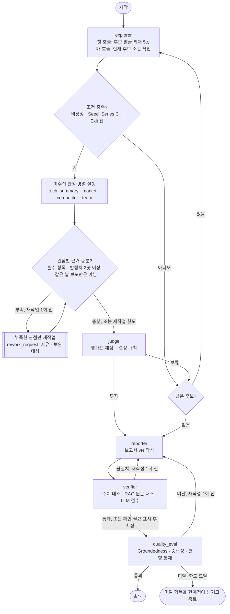
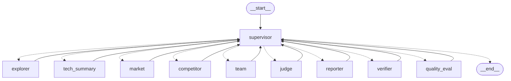

# AI Semiconductor Startup Investment Evaluation Agent

본 프로젝트는 국내 AI 반도체 스타트업에 대한 투자 가능성을 자동으로 평가하는 에이전트를 설계하고 구현한 실습 프로젝트입니다.

## Overview
- Objective : AI 반도체 스타트업의 기술·제품 성숙도, 시장성, 창업자·팀, 실적, 경쟁 우위, 투자조건을 기준으로 투자 적합성 분석
- Method : LangGraph Multi-Agent, Agentic RAG (Corrective RAG, Self-RAG)
- Tools : Tavily 웹 검색, Chroma 벡터 DB


## 시각화
해당 프로젝트가 실행되는 전 과정은 아래 Repo를 통해 시각화 하였습니다.

> 📌 https://github.com/97-99-02/web.git


## 차별점

| # | 차별점 | 어떻게 | 코드 |
|---|---|---|---|
| 1 | **LLM은 추출·채점, 계산과 결정은 코드** | LLM은 문서·기사에서 사실을 뽑고 기준표로 항목 점수를 매긴다. 조건 충족, 수치 원문 대조, 세부 분야 판정, 정보 부족 감점, 환산 점수, 투자/보류 결정은 코드 규칙으로 한다. 같은 점수면 항상 같은 결정이 나온다 | `explorer.is_eligible`, `market.number_in_source`, `judge.apply_evidence_rules`, `judge.decide` |
| 2 | **출처 목록은 코드가 만든다** | 점수표와 REFERENCE는 State에서 코드로 만든다. 본문 [n]은 LLM이 달지만, 코드가 인용된 출처만 REFERENCE에 남기고 번호를 다시 매기며, 목록에 없는 번호는 사실 검증에서 걸린다 | `agents/reporter.py`, `verifier.check_citations` |
| 3 | **3단계 사실 검증** | ① State 대조(값+단위, 코드) → ② RAG 원문 대조(Self-RAG: 관련성 검사, 검색어 재작성, 문장이 인용한 출처의 원문도 대조) → ③ LLM 검수. 불일치면 1회 재작성, 그래도 불일치면 "(확인 필요)" 표시. 검증 중 오류가 나면 멈추지 않고 "검증하지 못함"으로 기록 | `agents/verifier.py` |
| 4 | **문서 품질부터 보정** | KDB 보고서의 글꼴 손상 20쪽을 OCR로 다시 읽고, OCR이 빠뜨린 소수점은 원문과 대조해 고쳤다. 값이 뒤섞이는 그래프 숫자는 적재에서 뺐다 | `rag/ocr_fix.py`, `rag/ingest.py` |
| 5 | **근거마다 날짜를 붙인다** | 웹 근거에 게시일(Tavily → URL → 기사 페이지)을 붙여 LLM에 넘긴다. 계획 문장에는 기준 날짜를 달고, 날짜를 모르는 기사의 "내년·이달" 같은 표현은 쓰지 않는다 | `agents/web.py`, `tech_summary._time_ok`, `tech_summary._with_time` |
| 6 | **측정한 뒤 개선** | 임베딩 모델은 우리 문서로 비교해 골랐다. 시장성 평가는 정답지로 전후를 쟀고 효과가 없는 기법(Reranker)은 넣지 않았다. 점수 흔들림은 같은 코드로 다시 재서 원인을 확인한 뒤, 과거 평가와 크게 다르면 재채점하는 검증을 넣었다 | `eval/embedding/`, `eval/market/`, `judge.is_inconsistent` |

## Features
- 웹 검색 기반 평가 후보 발굴과 조건(비상장, Seed ~ Series C, Exit 전) 필터링
- 공공 연구기관 보고서(10편, 182쪽) 기반 기술·시장 분석 (RAG, 근거 부족 시 재검색)
- 평가표 기반 채점과 규칙 기반 투자/보류 결정, 보류 시 다음 후보로 반복
- 출처가 붙은 투자 보고서(마크다운, 제출용 PDF) 생성과 수치 사실 검증

## Tech Stack
- Framework : LangGraph
- LLM/Generator : gpt-4.1-mini (temperature 0)
- LLM/Judge : gpt-4.1 (생성 모델과 다른 모델)
- Retrieval : Chroma - Hit Rate@3 0.96, Hit Rate@5 0.98, MRR@5 0.837 (임베딩 선정 실험)
- Embedding : nlpai-lab/KURE-v1 (오픈소스, 후보 3종 비교 실험으로 선정)

## Agents
| 에이전트 | 도구 | LLM이 하는 일 | 코드가 하는 일 |
|---|---|---|---|
| 스타트업 탐색 | 웹 | 검색 결과에서 기업 정보 추출 | 상장 여부·투자 단계·Exit 조건 판정, 세부 분야 분류 |
| 기술 요약 | 웹 + RAG(tech) | 기업 사실(칩·공정·개발 단계·실적) 추출, 보고서 기준으로 해석 | 관련성·근거 일치 검사(Self-RAG), 부족한 항목만 재검색 |
| 시장성 평가 | RAG(market → tech) | 시장 규모·성장률·수요 요인 추출 | 수치 원문 대조, 단위 검증, 세부 분야 판정. 세부 분야 수치가 없으면 tech 문서 재검색(Corrective RAG) |
| 경쟁사 비교 | 웹 | 경쟁사·차별점 정리, 구분 판정 결과를 받아 비교 문장 다시 쓰기 | 같은 세부 분야만 비교, 선도 기업(대기업·상장사)/동급 기업(비상장) 구분 |
| 팀 분석 | 웹 | 창업자·핵심 인력 경력 정리 | - |
| 투자 판단 | - | 항목별 1~5점과 근거, 법률 리스크 | 정보 부족 감점, 환산 점수, 투자/보류 결정, 같은 기업 과거 평가와 크게 다르면 재채점(항목별 중앙값) |
| 보고서 생성 / 사실 검증 | RAG | 문장 작성, 원문 모순 검수 | 점수표·출처 생성, 수치 대조, 재작성 분기 |

## Architecture

**Supervisor 라우팅** (`agents/supervisor.py`의 라우팅 규칙. 모든 화살표는 하위 노드 → supervisor → 다음 노드다)



| 구조 | 동작 |
|---|---|
| 라우팅 | 모든 하위 노드는 실행 후 supervisor로 돌아오고, supervisor가 State(수집된 관점, 근거 충분도, 판단 결과, 보고서 검증 결과)를 보고 다음 노드를 정한다. 분기는 `add_conditional_edges` 하나이고, 결정과 사유는 `outputs/decisions/{trace_id}.jsonl`에 남는다 |
| 병렬 실행 | 아직 수집하지 않은 관점(또는 재작업할 관점)을 한 단계에 함께 실행하고, 모두 끝나면 supervisor가 한 번 판단한다 |
| 근거 충분성 판정 | 기술 요약은 핵심 칩·개발 단계·성능 수치·공개 매출·계약, 시장성은 세부 분야 시장 규모·성장률, 팀은 창업자·핵심 인력, 경쟁사는 같은 세부 분야 경쟁사가 있어야 한다. 관점마다 근거 발행처가 2곳 이상이고, 웹 근거가 모두 같은 날 보도면 안 된다 |
| 재작업 | 근거가 부족한 관점만 사유·보완 대상과 함께 다시 부른다(관점당 1회). 에이전트는 첫 실행과 다른 검색어로 찾고 이미 확인한 사실은 유지한다. 한도에 걸리면 정보 부족인 채로 판단한다(해당 항목 최대 2점) |
| 노드 안 재검색 | 기술 요약: 비어 있는 항목만 검색어를 바꿔 한 번 더 검색 / 시장성: 세부 분야 수치가 없으면 기술 문서까지 검색 |
| 투자 판단 안 일관성 검증 | 같은 기업·같은 평가 버전의 과거 기록(`outputs/judge_log.jsonl`)과 결정이 다르거나 5점 이상 차이 나면 seed를 바꿔 2회 재채점, 항목별 중앙값 사용 |
| 다음 후보 | 조건 미충족이나 보류면 다음 후보로 넘어간다(최대 5곳). 후보를 모두 평가해도 투자 기업이 없으면 '추천 기업 없음' 보고서를 쓴다 |
| 사실 검증 루프 | 불일치면 1회 재작성, 그래도 불일치면 해당 표현에 "(확인 필요)"를 표시하고 확정한 뒤 품질 평가로 |
| 품질 평가 루프 | 미달이면 미달 사유를 수정 지시로 넘겨 재작성(최대 2회). 한도에 도달하면 미달 항목을 보고서 한계점에 남기고 종료 |
| 오류 처리 | 하위 노드 예외는 노드별 대체 결과로 바꿔 supervisor가 다음을 정한다. 분석 노드 실패는 재작업 1회, 탐색 오류는 다음 후보, 판단 오류는 보류로 처리한다 |
| 종료 보장 | supervisor 실행 40회 상한(보고서가 없으면 지금까지 결과로 작성 후 종료), LangGraph `recursion_limit` 90 |

**코드에서 생성한 그래프** (`graph.py`를 LangGraph `get_graph().draw_mermaid()`로 그린 것, 점선은 조건부 분기)



하위 노드끼리 연결된 간선이 없고, 모든 노드는 supervisor로만 돌아간다(Star 구조). 다시 그리기: `uv run python -c "from graph import build_graph; print(build_graph().get_graph().draw_mermaid())"`

노드 이름: supervisor(조정), explorer(스타트업 탐색), tech_summary(기술 요약), market(시장성 평가), competitor(경쟁사 비교),
team(팀 분석), judge(투자 판단), reporter(보고서 생성), verifier(사실 검증), quality_eval(품질 평가).

## 투자 판단 기준

| 항목 | 비중 | 1점 | 2점 | 3점 | 4점 | 5점 |
|---|---|---|---|---|---|---|
| 기술·제품 성숙도 | 20% | 설계·아키텍처 단계 | FPGA 시제품 | 테이프아웃 완료 또는 엔지니어링 샘플 | 양산 시작 | 양산 제품을 복수 고객에 공급 |
| 시장성 | 30% | 세부 분야 시장 수치 없음 | 시장 규모 확인, 연평균 성장률 10% 미만 | 연평균 성장률 10~20% | 연평균 성장률 20% 이상 | 수십억 달러 이상 규모, 연평균 성장률 20% 이상 |
| 창업자·팀 | 25% | 창업자 정보 비공개 | 반도체 외 분야 경력 | 반도체 관련 경력(대기업 반도체 부문, 관련 분야 박사) | 반도체 분야 교수, 대기업 임원급 경력 | 4점 조건에 더해 창업·매각 경험이 있거나 핵심 인력까지 공개됨 |
| 실적·고객 검증 | 10% | 매출, 고객 없음 | MOU 또는 무상 PoC | 초기 매출(30억 원 미만) 또는 유상 PoC | 매출 30억 원 이상 또는 공급 계약 공개 | 매출 100억 원 이상 또는 대형 공급 계약 |
| 경쟁 우위 | 10% | 차별점 불분명 | 차별점을 주장하나 수치 근거 없음 | 성능 또는 전력 효율의 수치 우위 제시 | 3점 조건에 더해 특허 또는 자체 소프트웨어 개발 환경 보유 | 4점 조건에 더해 학회 발표 등 제3자 검증 |
| 투자조건 | 5% | 투자 정보 없음 | 라운드만 공개, 금액 비공개 | 라운드 금액과 투자사 공개 | 기업가치 공개 | 기업가치 공개, 전략적 투자자(대기업 등) 참여 |

- 환산 점수 = Σ(항목 점수 ÷ 5 × 비중), **70점 이상이면 투자**
- 비중 조정: 설계 때는 기술 30%, 시장성 25%, 창업자·팀 20%였다. 평가 대상 대부분이 양산 전이라 기술 점수가 최대 3점에 머물러 기술을 20%로 낮추고, 줄인 10%를 시장성과 창업자·팀에 5%씩 옮겼다
- 70점 이상이어도 보류: 핵심 항목(기술·팀) 1점 이하(설계 때는 2점 이하), 핵심 기술 관련 법률 리스크 미해소(출처가 있는 경우)
- 공개 정보로 확인할 수 없거나 출처가 없는 항목은 최대 2점 (근거 없이 높은 점수 방지)
- 핵심 항목이 2점 이하이면 투자여도 보고서에 주의 코멘트를 남긴다
- 같은 기업을 다시 평가했을 때 과거 기록(같은 평가 버전)과 결정이 다르거나 5점 이상 차이 나면 2회 더 채점해 항목별 중앙값을 쓴다

전체 기준표는 `agents/judge.py`의 `RUBRIC`, 가중치·임계값은 `config.py`에 있다.

## 평가·검증

### 1) Embedding 선정 실험

공개 리더보드 순위가 아니라 우리 문서 풀에서의 검색 성능으로 임베딩 모델을 골랐다. 코드: `eval/embedding/compare.py`

**방법**
- 문서 10편(182쪽)을 실제 파이프라인(`rag/ingest.py`)과 같은 방식으로 청크 450개로 분할 (tech 266, market 184)
- 문서 유형별로 청크 25개씩 무작위로 뽑아, gpt-4.1-mini가 그 청크로만 답할 수 있는 질문을 생성 → 평가 질문 50개 (`eval/embedding/qa_set.json`)
- 모델마다 청크와 질문을 임베딩하고, 설계대로 같은 문서 유형 안에서만 검색해 정답 청크의 순위를 측정

**결과** (`eval/embedding/results.json`)

| 모델 | Hit@1 | Hit@3 | Hit@5 | MRR@5 | 임베딩 시간 |
|---|---|---|---|---|---|
| BAAI/bge-m3 | 0.66 | 0.92 | 0.98 | 0.800 | 32.9초 |
| **nlpai-lab/KURE-v1** | 0.72 | **0.96** | **0.98** | **0.837** | **32.9초** |
| Qwen/Qwen3-Embedding-0.6B | **0.74** | 0.92 | 0.96 | 0.836 | 41.0초 |

**선정: KURE-v1**
- MRR@5는 Qwen3-Embedding과 거의 같고(0.837, 0.836), bge-m3보다 높다.
- 에이전트는 검색 결과 상위 4개를 참고하므로 1위 적중(Hit@1)보다 상위 3~5개 안에 드는지가 중요하다. Hit@3, Hit@5에서 KURE-v1이 가장 높다.
- 같은 문서를 임베딩하는 데 Qwen3-Embedding보다 약 20% 빠르다.

**한계**: 평가 질문이 50개라 모델 간 차이는 1~2문항 수준이다. 질문을 정답 청크에서 생성했기 때문에 표현이 겹쳐 Hit@5가 전반적으로 높게 나온다. 실험 이후 KDB 보고서의 글꼴 손상 쪽을 OCR로 보정하고 그래프 숫자를 빼서(`data/README.md`) 현재 적재 청크는 429개다.

### 2) 시장성 평가 개선

세부 분야 5개(데이터센터·엣지·차량용·인프라·기타)마다 문서에 실제로 있는 시장 수치를 정답지로 만들고(`eval/market/gold.json`), 실제 `market_node`를 돌려 뽑은 수치와 비교했다.

| 지표 | 의미 | 개선 전 | 개선 후 |
|---|---|---|---|
| 충분성 | 세부 분야 시장 규모·성장률을 모두 확보한 비율 | 0.8 | **1.0** |
| 재현율 | 반드시 뽑아야 하는 대표 수치 중 뽑은 비율 | 0.6 | **0.95** |
| 정밀도 | 대상 분야 수치로 뽑은 것 중 정답 비율 | 0.833 | **1.0** |

- **발견:** 정답 청크는 이미 모두 LLM에 전달되고 있었다(도달률 1.0). 병목은 검색이 아니라 **추출**이었다.
- **수정:** ① 프롬프트의 분야명 "기타"를 "AI 반도체 전체"로 (차트 범례 "기타"와 혼동) ② 단위 없는 값 제거 (차트 눈금값 "155", "524"가 채택되던 문제) ③ "데이터센터용 AI반도체"가 전체 시장 수치로 인정되던 판정 수정 ④ 그래프 숫자 제외 후 재적재
- **적용하지 않은 것:** Reranker(bge-reranker-v2-m3)로 검색 지표는 올랐지만(hit@4 0.524→0.619, MRR 0.394→0.512) 추출 결과는 같고 실행 시간이 2배 이상 늘었다.
- **한계:** 분야당 기업 1개, 2회 평균. 정답지는 팀이 원문을 보고 확정했다.

재현: `uv run python -m eval.market.evaluate --label <이름> --runs 2` (결과: `eval/market/results/summary.md`)

## Directory Structure
```
├── data/             # RAG 문서 풀 (tech/, market/), ocr/ (KDB 글꼴 손상 쪽 OCR 텍스트)
├── agents/           # 에이전트 모듈 (에이전트별 파일, 프롬프트 포함), web.py (공용 웹 검색)
├── rag/              # 문서 적재(ingest), 임베딩, 검색기, OCR 보정
├── eval/
│   ├── embedding/    # 임베딩 후보 비교 실험 (스크립트, 평가 질문, 결과)
│   └── market/       # 시장성 평가 정답지, 평가 스크립트, 결과
├── tests/            # 단위 테스트 (API 키 없이 실행)
├── outputs/          # 생성된 보고서 (마크다운, PDF), 채점 로그
├── state.py          # 공용 State 정의
├── graph.py          # LangGraph 흐름
├── config.py         # 모델·가중치·임계값 설정
├── app.py            # 실행 스크립트
└── README.md
```

## Usage
```bash
uv sync                           # uv가 없으면: pip install -r requirements.txt
touch .env                        # API 키를 넣는다 (.env·.env.*는 git에 올리지 않음)
uv run python -m rag.ingest       # 최초 1회: 문서 임베딩 → vectorstore/ (청크 429개)
uv run python app.py              # 보고서 생성 → outputs/report_*.md, 제출용 PDF

uv run --with pytest python -m pytest tests -q   # 테스트 (API 키 불필요)
```

## 투자 보고서 핵심 포인트

최종 보고서: `RAG-Output_울산캠퍼스-4반_강지수+김다은+이진우+이채목+장정훈.pdf` (4쪽)

**결론: 엑시나(인프라·CXL 메모리, Series B) 투자, 환산 점수 78.0점**
- 후보 5개(엑시나, 모빌린트, 디노티시아, 아티크론, 보스반도체) 중 첫 번째로 평가한 엑시나가 기준을 넘어 보고서를 생성했다

| 항목 | 점수 | 근거 |
|---|---|---|
| 시장성 (30%) | 5 | CXL 메모리 2023년 14백만달러 → 2026년 3,400백만달러, HBM 2024년 170억 → 2030년 980억 달러(연평균 33%), HBF 2030년 120억 달러 |
| 창업자·팀 (25%) | 5 | SK하이닉스 최연소 임원(SSD Firmware 부사장) 출신 대표, CTO·CPO까지 공개 |
| 기술·제품 성숙도 (20%) | 2 | 삼성전자 4나노 공정 CXL 3.0 프로토타입 개발 중. 테이프아웃·엔지니어링 샘플 근거 없음 |
| 실적·고객 검증 (10%) | 2 | 빅테크·하이퍼스케일러와 무상 PoC·MOU. 유상 계약·매출 미확인 |
| 경쟁 우위 (10%) | 3 | PCIe 6.0·CXL 3.2, RISC-V 코어 내장, SDK(XFLARE) 풀스택. 성능 수치 우위 근거 부족 |
| 투자조건 (5%) | 5 | 시리즈 B 약 2,000억 원, 기업가치 약 8,600억 원, 전략적 투자자 참여 |

- **핵심 리스크:** 기술 성숙도가 낮다(양산 전, 매출 전). 삼성전자·SK하이닉스·파두 같은 선도 기업과 파네시아 같은 동급 스타트업과의 경쟁이 심해지고, HBM 수율·공급 부족 같은 시장 리스크도 있다.
- **규칙이 드러난 부분:** 기술 2점은 보류 조건(1점 이하)에 해당하지 않지만, 보고서에 "⚠ 주의" 코멘트로 남았다. 법률 리스크는 "해당 없음"이다.
- **자동 검증:** 본문 수치 40/40 일치, 인용 15건 연결, 핵심 주장 4/4 근거 확인. RAG 원문 대조 6건 중 1건 불일치는 LLM이 "3,400백만달러"를 "34억 달러"로 환산해 쓴 표기다. 값은 같지만 원문에 없는 표기라서 검증기가 "(확인 필요)"로 표시했다.

## Lessons Learned

- LLM에게는 점수 판단까지만 맡기고 계산과 결정은 코드로 처리하니 결과가 안정적이었다. LLM에게 틀린 문장을 고치라고 하면 표현만 바꿔 버려서, 판단을 맡기기보다 확정된 사실을 먼저 넘겨주는 쪽이 나았다.
- 에이전트를 각자 만들어도 합쳐서 끝까지 돌려 보면 예상 못 한 문제가 나왔다. 가짜 데이터로는 멀쩡했는데, 실제로 돌려 보니 주의 문구가 글자 수로 잘려 문장 중간에서 끊긴 채 보고서에 나오기도 했다. 문제는 각자 맡은 부분보다 그 부분들이 이어지는 곳에서 생겼다. 서로 주고받는 데이터 형식이 곧 팀의 약속이라, 미리 맞춰 두고 바뀔 때마다 같이 확인해야 했다.
- 결과가 마음에 안 든다고 기준부터 바꾸기보다 원인을 먼저 확인해야 했다. 점수가 몇 분 사이에 흔들렸을 때 로직을 바꾸는 중에 쌓인 기록만 보고 원인을 단정했다가 틀렸고, 같은 코드로 다시 재고 나서야 LLM 해석 차이라는 걸 알았다. 시장성 평가도 검색이 약점이라고 보고 Reranker를 계획했지만, 정답지로 재 보니 병목은 추출이었다. Reranker는 검색 지표만 올리고 결과는 바꾸지 못했다.
- 사실 검증은 사실 자체를 가려내기보다, 앞 단계에서 넘어온 값을 잘못 옮겨 적지 않았는지 보는 도구에 가까웠다. 고치는 도구도 다시 확인해야 했다. OCR로 깨진 문서를 살렸더니 소수점이 빠지는 새 오류가 생겼다. 근거 검증 과정에서도 필요한 정보가 빠질 수 있어서, 제외 이유를 기록하고 빠진 항목은 다시 검색하면서 이미 검증한 사실은 유지하는 처리가 필요하다.

## Contributors
- 강지수 : 시장성 에이전트 재작업, 과제 해석(4관점·중립성), README
- 김다은 : 보고서 품질 평가 노드(코드 검사 + LLM Judge), 투자 판단 노드 예외 처리
- 이진우 : 보고서 재작성(품질 평가 수정 지시 반영), 사실 검증·품질 평가 연결, PDF
- 이채목 : State 설계, Supervisor(근거 충분성 판정·라우팅·결정 로그), Graph, 실행 설정·트레이스, 탐색·팀 분석·경쟁사 재작업
- 장정훈 : 기술 요약 에이전트 재작업, 진단 정보 State 분리

담당 영역과 영역 간 형식은 [docs/역할분담.md](docs/역할분담.md)에 있다.
